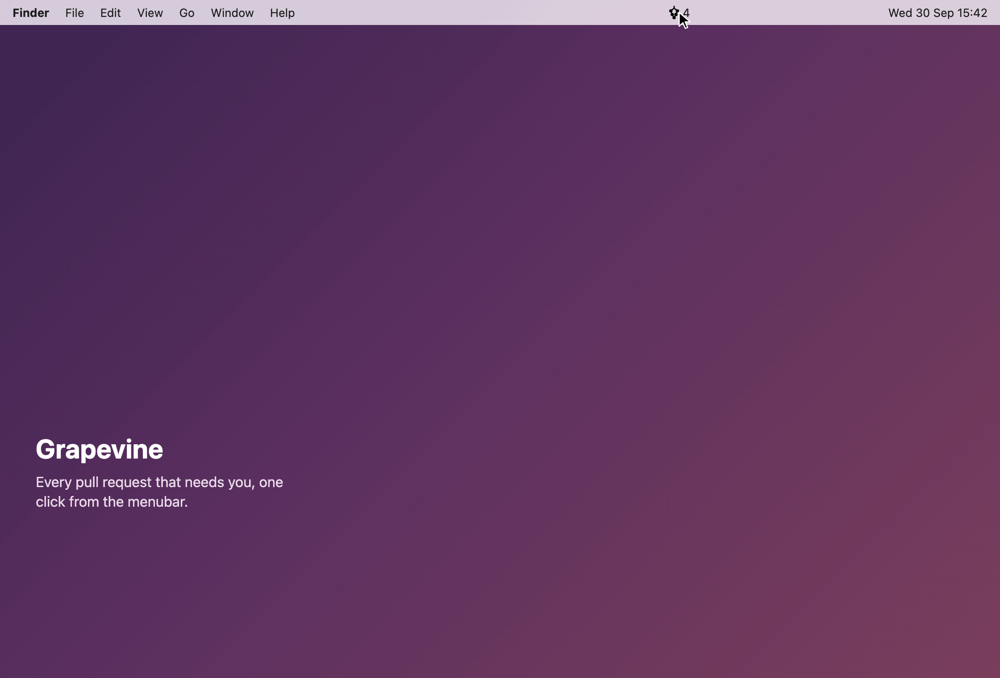

<!-- LOGO -->
<h1>
<p align="center">
  
  <br>Grapevine
</h1>
  <p align="center">
    A minimal menubar watcher for GitHub pull requests, for macOS and Ubuntu.
    <br />
    Add the repos you care about, watch their PRs. That is the whole app.
    <br />
    <a href="#about">About</a>
    ·
    <a href="#install">Install</a>
    ·
    <a href="#building">Building</a>
    ·
    <a href="#contributing">Contributing</a>
  </p>
</p>



## About

Grapevine lives in the menubar only, with no Dock icon. Clicking the tray icon
toggles a popover with the PR list, and clicking away dismisses it. You give it
a GitHub token and a list of repos; it polls them every few minutes and shows
the open PRs, split into the ones you authored, the ones you are involved in,
and everything else. The number in the menubar is how many of the first two
are waiting on you, and each of those rows says for how long. The first two
also badge comments and reviews you have not seen yet; everything else is a
browse list and stays silent. Each row badges the
organization's avatar onto the author's, flags drafts with a pill, shows a
green check once a PR's required approvals are in, shows a queued PR's
position in the merge queue, and shows a pill naming what still needs
attention (merge conflict, CI failing, changes requested, unresolved threads,
or behind base), collapsing the rest into a count when more than one applies.
The list is ordered by most recently updated. Merged PRs get their own section
until you dismiss them.

Grapevine is inspired by [Trailer](https://github.com/ptsochantaris/trailer),
which I used for years and still recommend. It is not a fork or a port, and
shares no code with it: Trailer is Swift and AppKit, Grapevine is Tauri, Rust
and React. Grapevine only reimplements the one slice of Trailer I reached for
daily. If you want issues as well as PRs, filtering, notification rules, GitHub
Enterprise, or any of this on a phone, Trailer already does all of that well
and you should use it instead.

### Non-goals

Grapevine deliberately does not, and will not:

- Track issues. Pull requests only.
- Offer saved views or custom filters. There are three sections, your turn
  comes first, and snoozed rows are folded away.
- Send system notifications. The number in the menubar is the whole signal.
- Support GitHub Enterprise or anything other than github.com.
- Handle more than one GitHub account at a time.
- Run anywhere other than a Mac menubar or an Ubuntu tray. No Windows, no iOS,
  no Android, no CLI.
- Ship on the App Store.

## Install

### macOS

Download the `Grapevine-v<version>-universal.zip` asset from the latest
[release](https://github.com/khiet/grapevine/releases), unzip it, and drag
`Grapevine.app` to `/Applications`. The build is universal and runs on both
Apple silicon and Intel Macs.

Releases are signed with an Apple Developer ID and notarized by Apple, so the
first launch opens normally with no Gatekeeper warning.

### Ubuntu

Current Ubuntu on x86_64 is the only supported Linux target. Other
distributions and architectures may work, but are not tested or claimed.

Download the `Grapevine-v<version>-amd64.deb` asset from the latest
[release](https://github.com/khiet/grapevine/releases) and install it from the
folder you downloaded it to:

```sh
sudo apt-get install ./Grapevine-v<version>-amd64.deb
```

`apt-get` pulls in the system libraries Grapevine needs. Start Grapevine from
the app grid; a grape icon appears in the top panel.

The tray works differently from the macOS menubar, because Ubuntu's tray does
not report clicks on the icon:

- Clicking the icon opens a menu. "Open Grapevine" opens the popover, and
  closes it when it is already open. "Quit Grapevine" stops the app.
- The popover appears in the top-right corner of the primary monitor instead
  of under the icon.

### Updates

Grapevine checks for new releases in the background and downloads them
without asking. When one is ready it offers a restart, so the manual download
is only needed the first time.

On Ubuntu, the restart asks for your password, because installing a `.deb`
needs administrator rights. Nothing is installed until you choose to restart,
and cancelling the password prompt leaves the current version running.

## Building

### Stack

- [Tauri v2](https://tauri.app) shell; hand-written Rust is limited to tray
  setup and popover window toggling (`src-tauri/src/lib.rs`)
- React + TypeScript + Vite frontend in the popover window

### Prerequisites

- macOS with Xcode Command Line Tools (`xcode-select --install`), or Ubuntu
  with these system packages:

  ```sh
  sudo apt-get install build-essential pkg-config file \
    libwebkit2gtk-4.1-dev libayatana-appindicator3-dev librsvg2-dev \
    libxdo-dev libssl-dev libdbus-1-dev
  ```

- [mise](https://mise.jdx.dev), which installs the pinned Node and Rust
  toolchains:

```sh
mise install
```

### Development

```sh
npm install
npm run tauri dev
```

### Tests

```sh
npm test           # frontend
npm run test:rust  # Rust
```

What the suites cannot reach on Ubuntu is verified by hand with the
[Ubuntu manual checklist](docs/ubuntu-checklist.md).

### Production build

```sh
npm run tauri build
```

The runnable app lands in `src-tauri/target/release/bundle/macos/Grapevine.app`.

On Ubuntu, build a `.deb` instead; it lands in
`src-tauri/target/release/bundle/deb/`:

```sh
npm run tauri build -- --bundles deb
```

CI builds the same x86_64 `.deb` for every pull request and uploads it as the
`grapevine-deb-x86_64` workflow artifact. It is for testing only: it carries no
updater signature and is not a release.

### Releasing

Releases are automated with
[release-please](https://github.com/googleapis/release-please). Merging a
Conventional Commit to `main` updates a standing release PR that bumps the
version in `package.json` and writes `CHANGELOG.md`; merging *that* PR tags the
release and builds the universal macOS app and the Ubuntu `.deb` onto it, then
publishes the updater manifest once both have built. `package.json` is the only
place the app version lives, so never bump a version by hand.

## Setup

Once the app is running, open the popover and go to settings.

1. Create a personal access token (classic) on GitHub. The "Create one on
   GitHub" link in settings opens [the new-token
   page](https://github.com/settings/tokens/new?scopes=repo&description=Grapevine)
   with `repo` pre-ticked and the description prefilled. `repo` is what covers
   private repos, but note that it grants read *and write* access to all of
   your private repositories; Grapevine only ever reads. If you only watch
   public repos, `public_repo` is the tighter choice.
2. Paste the token into settings. Grapevine stores it in the macOS Keychain, or
   the system keyring on Ubuntu, and never writes it to `settings.json`. Saving
   checks the scopes GitHub actually granted: a classic token without `repo`
   gets a notice that private repositories won't be visible, but the token
   still saves.
3. Add repos as `owner/name`, one at a time.

Fine-grained tokens are not recommended: they are scoped to a single resource
owner, and Grapevine holds one token, so a fine-grained token can only ever
watch repos belonging to one user or organization.

## Contributing

Bug reports and bug-fix pull requests are welcome.

For anything that adds behaviour, open an issue before writing code. Anything
on the Non-goals list above is a no by default, and the bar for a new feature
is high on purpose: staying small is the point of this app, not an accident of
it being young.

## License

[MIT](LICENSE).
